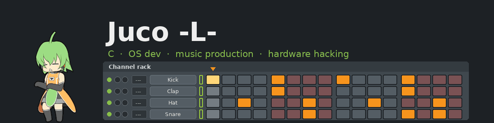
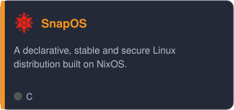
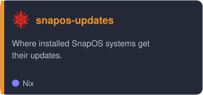
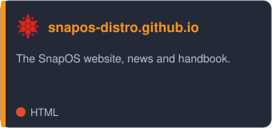
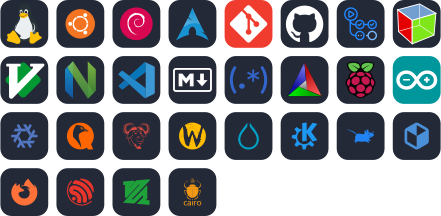
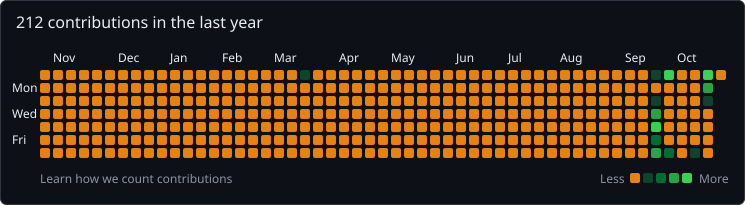
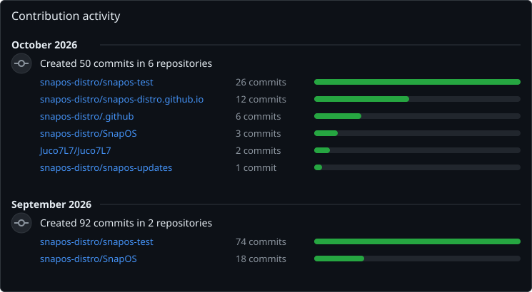

  

  15y · I love C and OS dev 🐢 
  Building <a href="https://snapos-distro.github.io">SnapOS</a>, the easy road to NixOS 
  Music production, soldering and hardware hacking

  
  
  

## 💻 Programming languages

## 🧰 Tools

## ⭐ Favorites

| | |
| --- | --- |
| 🐧 **OS** | NixOS, Gentoo, Source Mage, and the one I make: SnapOS |
| 🖥️ **Desktop** | Xfce |
| ⚙️ **Language** | C |
| 🎧 **Off the screen** | music production, soldering, hardware hacking |

## 🚀 What I am working on

<table>
  <tr><th colspan="3" align="left"></th></tr>
  <tr><th align="left">Project</th><th align="left">About</th><th align="left">Status</th></tr>
  <tr>
    <td>📁 <a href="https://github.com/snapos-distro/SnapOS"><b>SnapOS</b></a></td>
    <td>The distribution: releases and installer images</td>
    <td></td>
  </tr>
  <tr>
    <td>📁 <a href="https://github.com/snapos-distro/snapos-test"><b>snapos-test</b></a></td>
    <td>Where SnapOS is built and tested before a release</td>
    <td></td>
  </tr>
  <tr>
    <td>📁 <a href="https://github.com/snapos-distro/snapos-updates"><b>snapos-updates</b></a></td>
    <td>What installed systems update from</td>
    <td></td>
  </tr>
  <tr>
    <td>📁 <a href="https://github.com/snapos-distro/snapos-distro.github.io"><b>snapos-distro.github.io</b></a></td>
    <td>The website, news and the handbook</td>
    <td></td>
  </tr>
</table>

## 📈 Contributions

